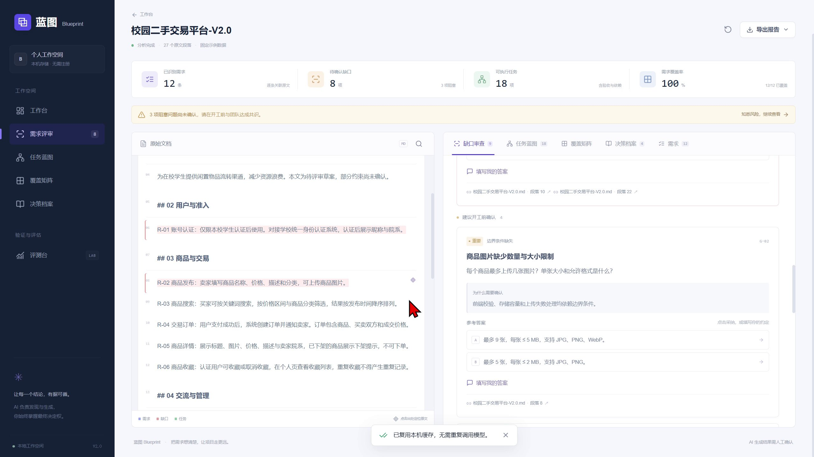

# 蓝图 Blueprint

AI 需求评审与任务拆解 Web 应用。上传需求文档，核对七类缺口，确认业务约定，再生成带验收标准、依赖关系和原文出处的任务。覆盖矩阵支持发现并补齐漏项，决策档案保存方案、理由和变更冲突。

## 团队与链接

| 项目 | 内容 |
| --- | --- |
| 学校 | 马鞍山学院 |
| 专业 | 软件工程 |
| 团队名称 | My2Cents |
| 团队成员 | 韩志伟、杜鹏辉 |
| 指导老师 | 刘东旭 |
| 参赛组别 | B组 |

GitHub 仓库：[chiron404/ForChuanzhiCompetition_My2Cents](https://github.com/chiron404/ForChuanzhiCompetition_My2Cents)（Public）。

克隆地址：`https://github.com/chiron404/ForChuanzhiCompetition_My2Cents.git`。当前应用无需登录。

## 技术架构

Next.js App Router + React + TypeScript + Tailwind CSS；Zustand 管理状态，IndexedDB 保存本机结果。PDF.js / Mammoth 在浏览器解析 PDF / DOCX，Markdown 保留段落与字符位置。

流程：解析 → EXTRACT → AUDIT → 人工确认 → PLAN → 结构、引用、DAG 与覆盖校验 → 导出。真实模式经服务端 `/api/llm` 调用兼容 Chat Completions 的模型接口，密钥仅由服务端读取。

## 安装运行

Node.js 声明要求 >=20.19；已有验收环境为 Node.js 24.15.0、pnpm 11.25.0。优先使用锁文件安装。请先安装 Node.js 和 pnpm；如尚无 pnpm，可运行 `npm install -g pnpm@11.25.0`。

```powershell
pnpm install --frozen-lockfile
# 仅在 .env.local 不存在时复制
if (-not (Test-Path .env.local)) { Copy-Item .env.example .env.local }
npm run dev
```

访问 http://127.0.0.1:3000/。该地址仅供本机访问。生产运行先 `npm run build`，再 `npm start`。安装后 postinstall 准备本地 PDF worker 和样例文档。

## 环境配置

```dotenv
LLM_API_KEY=
LLM_BASE_URL=https://api.deepseek.com/v1
LLM_MODEL=deepseek-chat
LLM_CONFIG_VERSION=1
```

密钥留空使用演示模式；修改配置后重启服务。不要使用 NEXT_PUBLIC_ 保存密钥，也不要提交实际 `.env.local`。真实模式会向模型服务发送必要的文本及上下文，原始文件在浏览器解析。

## 校验与评测

```powershell
npm run typecheck
npm test
npm run evaluate
npm run build
```

2026-10-19 验收记录包含 19 项测试、类型检查和生产构建通过；接口测试使用替身响应。本次报告制作没有重跑这些命令。固定样例自检用于验证管线，不能作为真实模型准确率。真实模型质量、费用与时延尚未实测，独立干净环境完整安装仍待验证。

## 评审体验

示例文档 → 原文出处 → 缺口答复 → 重新拆解 → 粒度与依赖 → 移除图片任务 → 矩阵红格补充 → 决策冲突 → 自检 → Markdown / JSON 导出。

演示样例为 12 需求、9 缺口、4 决策；三档任务为 9 / 18 / 36 项。其他文档在演示模式中只提供明确占位。覆盖率只针对已抽取需求。最新修改快照与初始分析缓存分开保存，再次载入文档时需核对是否复用了旧结果。

## 当前边界

未实现图片或截图理解、扫描 PDF OCR、自主工具调用、MCP 服务、向量 RAG、账号、多人协作和外部看板同步。跨块冲突及跨批依赖可能遗漏。工时与置信度是建议，图校验和逐字引用不能代替人工业务复核。

## 目录

`src/app` 页面与服务端接口；`src/components` 分域交互；`src/types` 数据契约；`src/lib` 解析、AI 编排、图与覆盖校验、存储及导出；`src/store` 状态；`tests` 自动化案例；`docs` 需求与验收资料。

## 开发与依赖

保留现有 Git 开发历史。使用第三方库，许可证以安装包及锁文件为准。开发过程使用 AI 辅助工具，参赛成员应理解代码并能解释设计。公开发布前确认密钥、临时文件和无关材料未进入仓库。

## 参赛材料与上传

| 材料 | 入口 |
| --- | --- |
| 技术报告（18 页 PDF） | [下载技术报告](<docs/参赛材料/01 蓝图Blueprint 技术报告.pdf>) |
| 运行与评审手册（6 页 PDF） | [下载评审手册](<docs/参赛材料/02 蓝图Blueprint 运行与评审手册.pdf>) |
| 全部材料、可编辑文稿与提交状态 | [材料目录](docs/参赛材料/README.md) |
| 依赖及锁定版本 | [依赖清单](docs/参赛材料/依赖清单.md) |
| 环境变量模板 | [.env.example](.env.example) |
| 团队信息 | [团队信息表](docs/参赛材料/团队与链接信息.md) |
| GitHub 上传步骤 | [上传说明](上传GitHub说明.md) |



本副本保留原有两次开发提交和后续材料整理、信息更新提交。应用代码与 `5885359` 一致；报告中的历史测试及实现结论以该版本为基线，材料整理不代表新增测试结果。`.git` 保存本地历史，推送时由 Git 传输提交记录。学校、专业、B组、团队、成员姓名、指导老师及 GitHub 仓库地址已同步。公开仓库已创建，本地最新代码、报告与历史尚需推送核验。视频需要另行完成并提交。
