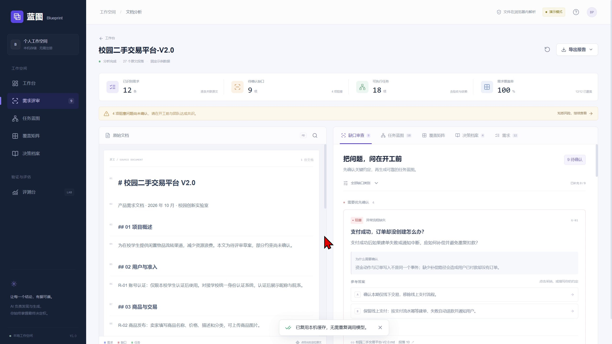
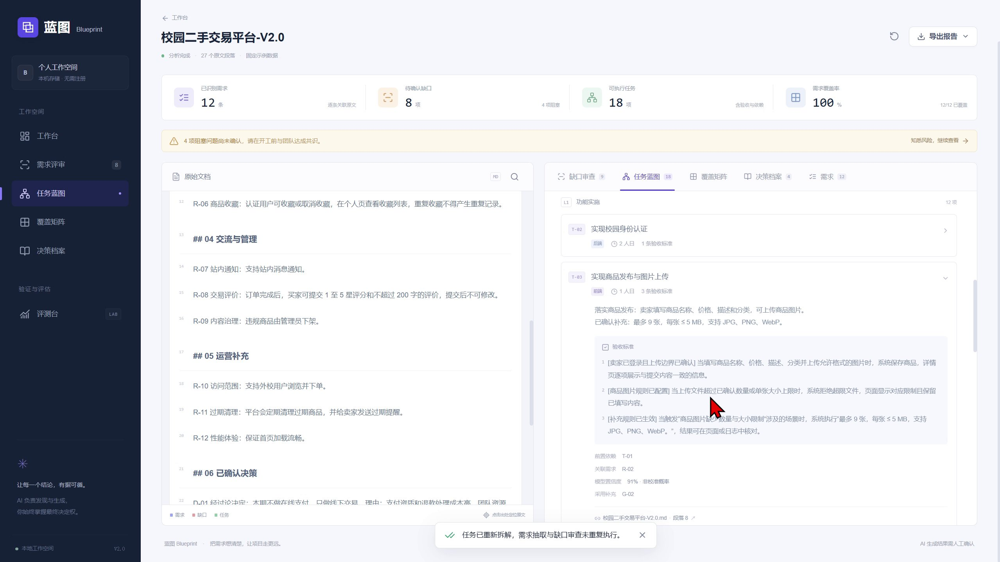
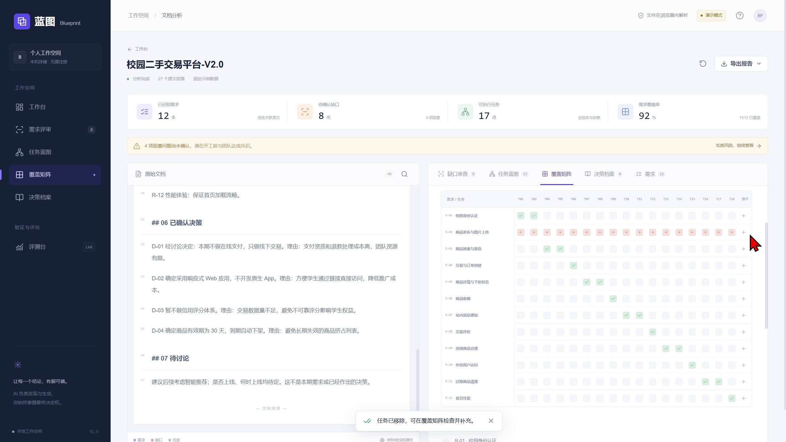
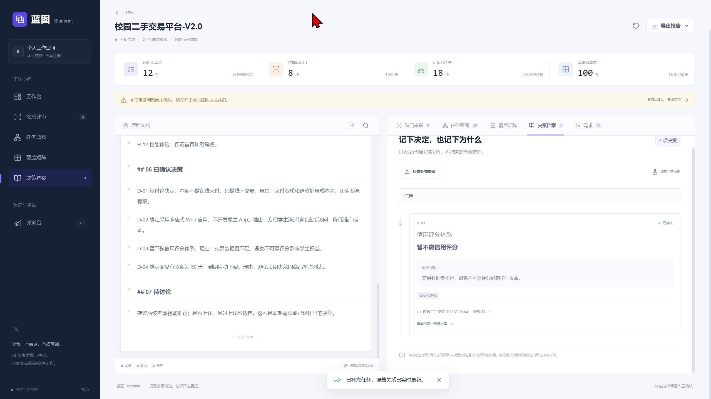

# 蓝图 Blueprint 技术报告

对应 PDF 第 1 页

AI 需求评审与任务拆解 Web 应用

全国高校 AI Web 开发挑战赛  校赛提交材料

| 参赛信息 | 内容 |
| --- | --- |
| 学校名称 | 马鞍山学院 |
| 专业 | 软件工程 |
| 参赛组别 | B组 |
| 团队名称 | My2Cents |
| 团队成员 | 韩志伟、杜鹏辉 |
| 指导老师 | 刘东旭 |
| 代码仓库地址 | https://github.com/chiron404/ForChuanzhiCompetition_My2Cents.git |
| 仓库可见性 | Public（公开） |

> 版本范围：产品 V2 校赛版，工程版本 0.1.0。报告日期：2026 年 10 月 28 日。实现基线：本地提交 5885359；已有验收记录日期：2026 年 10 月 19 日。

本报告说明项目需求、系统架构、AI 集成、核心交互、测试与部署方案，并明确当前实现边界。固定样例用于演示与自检；真实模型效果尚未完成实测。

---

# 项目摘要与阅读导航

对应 PDF 第 2 页

蓝图面向学生项目组、独立开发者和初级产品人员，将需求文档转化为可核对的评审结果。用户上传文档后，系统抽取需求、发现缺口、接收人工答复、拆解任务，并通过原文出处、依赖校验和覆盖矩阵支持复核。已确认决策被单独整理，补充决策可以触发冲突提示。

项目的设计重点是让生成内容进入可检查的工作流程：AI 生成结构化建议，程序校验结构与来源，人确认业务约定。当前具备可运行的多阶段 AI 接口和完整固定样例交互，尚未完成真实模型泛化、成本与延迟测试。

| 章节与内容 | 页码 |
| --- | --- |
| 项目摘要与阅读导航 | 2 |
| 场景需求与功能范围 | 3 |
| 产品流程与交互证据 | 4 |
| 系统架构与技术选型 | 5 |
| 数据契约与原文溯源 | 6 |
| AI 工作流与模型接入 | 7 |
| 缺口审查与人工确认 | 8 |
| 任务拆解与依赖校验 | 9 |
| 覆盖矩阵与遗漏修复 | 10 |
| 决策档案与冲突判断 | 11 |
| 前端工程与状态恢复 | 12 |
| 安全可控性与数据处理 | 13 |
| 测试证据与验收结果 | 14 |
| 评测方法与结果边界 | 15 |
| 运行部署与运维方案 | 16 |
| 技术创新与应用价值 | 17 |
| 总结展望与实现依据 | 18 |

> 材料依据为项目源码、PRD、已有验收记录和用户录屏。未采用未经证实的市场规模、效率倍数、真实模型准确率或比赛得分预测。

---

# 场景需求与功能范围

对应 PDF 第 3 页

## 目标用户与问题

| 用户 | 工作中的问题 | 对应能力 |
| --- | --- | --- |
| 学生竞赛与毕设团队 | 需求不清楚，缺乏拆解经验 | 七类追问、角色与验收标准 |
| 独立开发者与小型团队 | 客户约定模糊，执行范围易变 | 原文核对、边界确认、报告导出 |
| 产品助理与新成员 | 历史决定难找，变更理由不清 | 决策档案、理由检索、冲突提示 |

## 功能范围

| 优先级 | 需求编号 | 实现范围 |
| --- | --- | --- |
| P0 | FR-01 至 FR-07 | 解析、原文高亮、需求抽取、七类审查、任务拆解、依赖分层、覆盖矩阵 |
| P0 | FR-11、FR-13 | 示例体验、阶段进度、失败重试与部分结果保留 |
| P1 | FR-08 至 FR-10、FR-12 | 决策档案与冲突、三档粒度、导出导入、评测台 |
| P2 | FR-01b | 图片与截图输入尚未实现 |

## 质量要求与验收方向

每条分析对象必须携带可验证的来源；任务包含明确验收标准和依赖；未覆盖需求在矩阵中可见；异常文件与模型错误应给出可理解提示。界面支持桌面与移动端，分析结果保存在本机浏览器。

当前不提供多人协作、账号体系、任务流转看板、拖拽排期或外部系统同步。PDF 读取文本层，不承担扫描件 OCR；重排阅读器不等同于原 PDF 版面还原。

> 需求依据：产品需求文档 V2 的 FR-01 至 FR-13；实际实现范围以代码和本报告说明为准。

---

# 产品流程与交互证据

对应 PDF 第 4 页

用户从上传区或示例入口开始。解析后的原文保留在左侧，右侧按缺口、任务、覆盖、决策和需求分区。顶部状态汇总用于判断分析规模与待确认问题；未答复的阻塞问题持续提示。

流程图：读取文档 → 核对缺口 → 确认答复 → 生成任务 → 检查覆盖



典型流程是先核对冲突，再确认图片上传限制，重新拆解并检查任务验收标准；随后主动移除一项任务，在覆盖矩阵中补齐；最后查看决策冲突、运行自检并导出结果。

> 录屏约 5 分 4 秒，属于固定样例演示。页面出现缓存复用，不能据此将响应速度解释为真实模型推理速度；中途计数变化也不构成真实效果评测。

---

# 系统架构与技术选型

对应 PDF 第 5 页

流程图：浏览器工作台 → Next.js 服务端 → 模型服务；应用编排 → 确定性复核 → 交付与保存

| 层次 | 技术与职责 | 选型理由 |
| --- | --- | --- |
| Web 界面 | Next.js App Router、React、TypeScript | 页面、服务端代理与类型契约位于同一工程，便于学生团队维护 |
| 交互与状态 | Tailwind CSS、Zustand、IndexedDB | 复用组件与状态；本机缓存减少重复分析 |
| 文档解析 | PDF.js、Mammoth、Markdown 解析 | 浏览器侧读取文件，并形成统一段落和位置结构 |
| 模型接入 | 服务端兼容 Chat Completions 接口 | 通过配置切换模型服务，密钥不进入前端包 |
| 质量约束 | Zod、JSONrepair、确定性算法 | 约束输出形状，修复格式，并检查来源和依赖 |

后端承担模型接入与输出校验，不承担用户账号或业务数据库。前端保留解析、工作流状态、交互呈现与结果保存职责，使作品主要价值直接呈现在 Web 界面。

> 当前没有接入 Vercel AI SDK、模型自主工具调用、MCP 服务或向量 RAG。多阶段流程由应用代码编排。

---

# 数据契约与原文溯源

对应 PDF 第 6 页

| 对象 | 关键字段 | 用途 |
| --- | --- | --- |
| ParsedDoc / Paragraph | 文本、段落 ID、起止位置、页码、标题层级 | 统一文档输入及定位 |
| SourceRef | docId、locator、quote、offset | 连接分析结论与原文 |
| Requirement / Gap | 类别、严重度、追问、resolution、source | 抽取需求并保存人工确认 |
| TaskNode | 角色、工时、AC、deps、requirementIds、source | 组织可分工任务及验证依据 |
| Decision / Conflict | 方案、理由、范围、状态、双方来源 | 保存已确认决策及变化冲突 |
| AnalysisResult | version、mode、granularity、logs、附加文档 | 缓存、导出与可验证恢复 |

## 定位流程

解析保留原始字符串位置。模型返回段落 ID 与摘录，服务端核对摘录存在于给定段落后绑定位置。页面根据同一位置进行高亮，需求、缺口、任务和决策可以共用来源组件。

```text
source.docId === document.id
document.text.slice(start, end) === source.quote
0 <= start < end <= document.text.length
```

offset 使用 JavaScript 字符串索引，即 UTF-16 代码单元位置，不是 UTF-8 字节数。重复摘录在同一段落中的定位目前依赖首次匹配；逐字匹配证明引用确实存在，但不能单独证明模型对该句的语义解释正确。

## 文档约束

单文件上限为 20 MB。长段落按最多 3000 个字符串单位拆开；分析块的段落文本长度合计不超过 4000，容量允许时保留前一段上下文。这是代码长度约束，并非模型 token 上限。

> 实现依据：src/types/index.ts、src/lib/document.ts、src/app/api/llm/route.ts。

---

# AI 工作流与模型接入

对应 PDF 第 7 页

| 阶段 | 主要输入 | 输出与控制 |
| --- | --- | --- |
| EXTRACT | 分块原文、段落 ID | 需求与已确认决策，带原文摘录 |
| AUDIT | 原文块与相关需求 | 七类缺口、追问、原因、严重度和建议 |
| PLAN | 需求、相关原文、已回答缺口、粒度 | 任务、验收标准、依赖、角色和工时 |
| CONFLICT | 补充决策与召回的历史候选 | 互斥关系及原因，保留双方依据 |

## 模型选择与集成

默认配置指向 DeepSeek 兼容接口和 deepseek-chat 模型名；这是可配置的初始设置，并非模型效果比较后的实测最优结论。选型依据是接口兼容、中文结构化任务适配需求及服务端配置便利，最终模型需通过未见文档评测确定。

客户端向 /api/llm 提交阶段和文本上下文。服务端组织角色提示与 JSON 结构要求，接收返回文本后尝试 JSON 修复、结构验证和引用绑定。/api/config 仅返回模式和配置标识，不返回密钥。

## 长文与重复请求控制

抽取与审查按文档块执行；拆解按不超过 8 条需求分组，并构造合计不超过 4000 个字符串单位的原文上下文。批次任务合并时重映射编号与依赖。粒度变化仅重跑拆解，本机缓存用于复用已有分析。

> 分块降低单次上下文压力，但跨块矛盾和跨批任务依赖可能遗漏。阶段进度展示应用运行状态，不是逐字流式输出或模型内部思考轨迹。

---

# 缺口审查与人工确认

对应 PDF 第 8 页

| 类别 | 样例中的检查问题 |
| --- | --- |
| 异常流程 | 支付成功但创建订单失败时如何处理 |
| 边界条件 | 商品图片数量、大小、格式如何限制 |
| 非功能需求 | “首页流畅”对应什么可测性能条件 |
| 验收标准 | 站内通知如何判定发送与展示成功 |
| 表述歧义 | “定期清理”何时执行、按什么条件清理 |
| 文档矛盾 | 仅本校使用与外校可下单；线上支付与线下交易范围 |
| 外部依赖 | 校园统一身份认证的接口及可用条件是否确认 |

缺口按阻塞、重要、建议三个级别组织。卡片展示问题、确认原因、参考答案和原文出处。用户可以采纳选项或填写自己的答案；结果记录答复文本与时间，后续拆解据此生成更具体的任务。


> 严重度与建议答案需要人工复核。已有任务覆盖率较高，也不等于所有阻塞问题均已解决；两种状态在界面上分开提示。

---

# 任务拆解与依赖校验

对应 PDF 第 9 页

每个任务包含标题、说明、验收标准、角色、建议工时、前置依赖、需求编号及原文来源。工时范围为 0.5 至 5 人日；置信度为模型字段，尚未经过概率校准。三档粒度用于匹配整体评审、团队分工和具体执行的不同需求。



## 依赖校验

校验先去重依赖，再过滤未知编号和自依赖；构建已接受边时检查是否形成循环，必要时断开对应边并记录日志。之后使用 Kahn 拓扑分层，确定展示层级。算法修正的是图结构，断边后的业务先后关系仍需团队确认。

## 验收标准

任务采用“前提、操作、系统结果”的句式，并对空洞措辞进行规则检查。例如上传超限文件时应拒绝文件、显示限制并保留已填内容。句式合格不等于业务条件完备，复杂场景需要补充人工测试。

> 固定样例三档为概览 9、标准 18、详细 36 项，不应当作任意文档的任务数量承诺。实现：src/lib/graph.ts、src/lib/pipeline.ts。

---

# 覆盖矩阵与遗漏修复

对应 PDF 第 10 页

覆盖矩阵将已抽取需求与任务逐项关联，帮助发现“需求存在但任务遗漏”的情况。它由代码计算，不直接采用模型自报的覆盖百分比。

```text
覆盖成立 = 任务显式关联该需求 AND
（任务来源与需求来源在同一文档中区间重叠
 OR 任务采用的已回答缺口与该需求来源区间重叠）
```

同一缺口不能替任意需求提供覆盖。没有任务关联的需求显示红格，点击后可查看原文、填写任务和验收标准，提交即重算矩阵。排除项可以记录理由，但不会因此被冒充为已覆盖任务。



录屏演示了 18 项任务减少为 17 项，12 条需求中有 11 条被覆盖，11/12 约为 91.67%，界面四舍五入显示 92%。补充任务后恢复为 100%。

> 覆盖率分母是已抽取需求，不包含漏抽但尚未识别的需求。100% 只说明关联完整，不能证明软件已经开发完成或需求理解完全正确。

---

# 决策档案与冲突判断

对应 PDF 第 11 页

决策档案用于保存文档中已经确认的决定，包括方案、理由、约束、影响范围和出处。未记录的备选方案或参与人保持缺省说明，不补造事实。搜索匹配决策主题、方案、理由和范围。



## 补充决定的检查流程

补充文档先抽取决策，再按主题词与影响范围寻找历史候选。在真实模式下，由模型判断是否互斥，冲突结果保留历史决定、补充决定、理由及双方原文。页面提供固定冲突示例，便于在无模型密钥时演示交互。

样例中，历史决定暂不做信用评分，理由是交易数据不足；补充决定要求本期上线并用于交易准入。系统并列显示矛盾，用户可以在两份文档之间跳转核对。

> 当前属于轻量候选召回与冲突判断，不是向量数据库 RAG。关键词召回可能遗漏近义表述；未提示冲突不能解释为不存在冲突，系统也不会自动覆盖旧决定。

---

# 前端工程与状态恢复

对应 PDF 第 12 页

| 模块 | 职责与工程处理 |
| --- | --- |
| 页面与组件 | 首页、结果页、评测台；按原文、缺口、任务、矩阵、决策分域；共享来源标签和状态提示 |
| 类型与状态 | TypeScript 严格模式；Zod 数据契约；Zustand 统一管理分析结果、阶段和选择状态 |
| 性能策略 | PDF.js 与 Mammoth 按需加载；本地 PDF worker；缓存已有分析；粒度切换只执行 PLAN |
| 交互反馈 | 阶段进度、可理解错误、重试入口、阻塞提示、任务移除及补充后的统计更新 |
| 响应式布局 | 桌面原文与分析并列；移动端切换原文与结果；点击出处定位相应内容 |
| 本机持久化 | IndexedDB 保存分析数据；不可用时退化到当前会话，并提示存储限制 |

## 失败与恢复

工作流在 parse、extract、audit、plan、validate 等阶段更新状态。失败时在当前页面保留已完成数据并提供重试，但未逐阶段持久化落盘。阶段重试与服务端修复是两层机制，长文档可能产生多次请求，不能描述为整个任务最多调用两次。

## 导出与导入

Markdown 报告面向阅读，JSON 保存完整结构。导入校验文档、段落、实体编号及来源。初始分析缓存包含内容指纹、配置标识和粒度；答复与重拆另写入最近快照。刷新可恢复最近快照，但再次加载同一文档可能命中较早分析缓存，需核对结果并及时导出备份。

已记录 390、900、1440 像素宽度下的人工检查。尚无系统性 Lighthouse、首屏时间、内存峰值或大规模文档压力测试，性能策略不等同于已取得量化性能结论。

> 实现依据：src/components、src/store/index.ts、src/lib/storage.ts、src/lib/export.ts。

---

# 安全可控性与数据处理

对应 PDF 第 13 页

| 风险 | 当前处理 | 剩余边界 |
| --- | --- | --- |
| 文档中的恶意指令 | 将输入作为不可信数据；提示不得服从文档指令；页面按文本渲染 | 提示约束和结构校验不能彻底消除语义误导 |
| 模型伪造引用 | 逐字核对来源并绑定字符位置，失败则修复或拒绝 | 原文存在不代表推断必然正确 |
| 密钥泄漏 | 密钥仅由服务端环境变量读取，不进入客户端配置与报告 | 运行环境和日志仍需运维检查 |
| 输出异常 | JSON 修复、Zod 校验、阶段重试、错误提示 | 失败与重试会增加延迟和调用费用 |
| 敏感文档处理 | 文件在浏览器解析，真实模式仅发送所需文本及上下文 | 文本仍会交给所配置的外部模型服务 |
| 本机结果保存 | IndexedDB 本机存储，导出前由用户确认内容 | 不等于加密保险库；共享设备需注意数据访问 |

## 控制边界

真实模型调用失败时不静默替换为固定演示数据。不同模式有可见标识；非示例文档在演示模式中使用明确占位说明，避免将预设输出当作对用户文档的真实分析。

服务端已限制 JSON 请求长度及原文块大小，但尚无用户认证、配额、速率限制、服务端审计或租户隔离。开放真实模型接口到公网前，应补充访问控制、用量限额和运行监控；本报告不宣称这些运维能力已完成。

> 原文件不上传，不等于“数据完全不出浏览器”。真实模式必须向模型服务发送文本和相关分析上下文，应在体验说明中如实告知。

---

# 测试证据与验收结果

对应 PDF 第 14 页

以下结果来自 2026 年 10 月 19 日验收记录，2026 年 10 月 27 日编写报告时未重新运行构建或测试，以保持工程文件不变。接口测试使用替身响应，没有真实外部模型调用。

| 检查层次 | 已有结果 | 证据或覆盖 |
| --- | --- | --- |
| 类型与构建 | TypeScript 检查通过；生产构建通过 | 已有本地验收记录 |
| 自动化测试 | 19 项通过 | tests/core.test.ts 14 项；tests/api.test.ts 5 项 |
| 固定样例自检 | 12 需求、9 缺口、4 决策；无失败项 | npm run evaluate 的已有记录 |
| 浏览器交互 | 答复进入任务；粒度切换；覆盖补齐；决策冲突 | 验收记录及用户录屏 |
| 文件与恢复 | PDF、DOCX、MD；JSON 导入与刷新恢复 | 文本层解析、来源保留、错误提示 |
| 响应式检查 | 390、900、1440 像素宽度人工验证 | 无明显横向溢出，移动端来源切换可用 |

## 关键自动化案例

测试覆盖 CRLF、重复文本和 Unicode 字符位置；空文档与伪造来源；超长分块；自环、未知依赖与三节点循环；缺口不能误覆盖全部需求；任务移除与补齐；三档数量；JSON 篡改拒绝；缺口答复进入任务；阶段重试；PLAN 分批编号重映射。

接口契约测试检查无密钥行为、JSON 尾逗号修复、伪造摘录重试后拒绝、不接受原文件上传或超长原文块，以及模型服务错误不泄露上游正文。

> 尚未验证：真实模型准确率、模型延迟和成本；第二个干净环境完整安装；压力并发与公网可用性。安装过程中曾遇到网络超时，不能将当前机器可运行等同于跨机器安装已验证。

---

# 评测方法与结果边界

对应 PDF 第 15 页

| 指标 | 计算口径 | 固定自检 |
| --- | --- | --- |
| 缺口召回率 | 匹配金标准缺口数 / 9 | 100% |
| 缺口精确率 | 一对一匹配缺口数 / 预测缺口数 | 100% |
| 严重度准确率 | 严重度正确数 / 已命中缺口数 | 100% |
| 需求覆盖率 | 被有效任务覆盖的已抽取需求 / 已抽取需求 | 100% |
| 任务溯源率 | 来源引用全部有效的任务 / 全部任务 | 100% |
| 验收标准合格率 | 通过句式与空洞措辞规则的 AC / 全部 AC | 100% |
| 需求抽取召回率 | 原文区间匹配的金标准需求 / 12 | 100% |
| 决策抽取 F1 | 基于原文匹配的精确率与召回率调和均值 | 100% |

缺口匹配采用相同类别及原文区间重叠，并一对一计数，避免仅靠固定编号判定。失败案例列出漏检、未匹配预测、严重度不符或来源问题。指标与匹配口径一起呈现，便于复跑和复核。

> 以上 100% 是预置样例在已有自检中的结果，用于验证管线和展示一致性；数据与预设输出高度耦合，不能用于证明真实模型准确率或泛化能力。当前只有一份人工构造金标准。

## 下一阶段评测设计

新增不同领域、不同长度的未见文档；由两名评审分别标注，再复核分歧。保留固定数据划分、模型配置、提示词版本、调用次数和失败记录，报告宏平均指标及逐文档结果。

针对原文引用、人工答复、分块策略和覆盖校验分别设计消融对照，检查每个环节是否减少漏项或降低错误。另记录请求总耗时与实际费用；当前不提供“90 秒以内”或“1 元以内”等未经测量的保证。

---

# 运行部署与运维方案

对应 PDF 第 16 页

## 本地复现

工程要求 Node.js 20.19 或更高版本，packageManager 声明 pnpm 11.25.0；已有机器使用 Node.js 24.15.0。应在可用网络环境中安装锁定依赖，安装后演示模式不需要模型密钥。

```text
pnpm install --frozen-lockfile
Copy-Item .env.example .env.local
npm run dev
# 浏览器打开 http://127.0.0.1:3000/
```

已有 .env.local 时保留原配置，不执行覆盖复制。生产运行先 npm run build，再 npm start。首次安装后的 postinstall 脚本准备本地 PDF worker 与示例文档；安装成功不等于真实模型配置成功。

| 环境变量 | 含义 |
| --- | --- |
| LLM_API_KEY | 服务端模型密钥；为空时使用演示模式 |
| LLM_BASE_URL | 兼容接口基础地址；默认 https://api.deepseek.com/v1 |
| LLM_MODEL | 模型名称；默认 deepseek-chat |
| LLM_CONFIG_VERSION | 配置或提示词变更后递增，用于缓存隔离 |

## 公网部署方案与当前状态

可将工程部署到支持 Next.js 服务端路由的环境，并配置构建命令、服务端变量与 HTTPS。现有启动脚本绑定 127.0.0.1，适合本机体验；自建服务器需要另外配置对外监听和反向代理。

代码仓库已创建并设为 Public，地址见封面；本地最新代码、报告与历史仍需推送核验。真实模式部署前应验证平台函数时限、模型超时、重试开销和配额；评审账号当前不适用，因为应用尚未实现登录。

> 详细安装步骤、故障排查、依赖清单和评审路径见配套《运行与评审手册》。本报告没有执行公网部署或修改工程配置。

---

# 技术创新与应用价值

对应 PDF 第 17 页

| 创新点 | 具体实现 | 验证方式 |
| --- | --- | --- |
| 贯穿流程的原文依据 | 需求、缺口、任务、决策共享来源结构，引用可逐字核对 | 点击出处；篡改引用导入被拒绝 |
| 从缺口答复到可执行任务 | 人工确认进入任务说明与验收标准，修改粒度复用前序分析 | 图片限制出现在任务卡 |
| 生成结果的确定性复核 | 覆盖计算同时检查显式关联和来源；依赖校验留下修正日志 | 删除任务产生红格；异常依赖测试 |
| 带理由的决策变化核对 | 历史与补充方案并列，理由和双文档出处可查 | 信用评分固定冲突示例 |
| 可解释的评测界面 | 公开匹配规则、失败案例，区分演示自检和真实模型评测 | 评测台与可复跑脚本 |

## 应用与交互创新

蓝图将评审问题直接嵌入需求阅读场景，让用户在原文旁确认约定；任务生成后继续检查覆盖，而不是结束于一份长文本。使用者可以沿着“依据、问题、答复、任务、核对”逐步完成工作。上述创新是本项目的组合设计，不主张算法首创或对所有同类产品的绝对优势。

## 社会价值与可持续性

面向学生团队的价值在于帮助新成员学习需求澄清、验收表达与决策记录。界面无需账号即可体验，固定样例降低了试用门槛。是否实际减少返工仍需用户研究和对照任务验证。

未来可探索教学实践辅助、个人项目订阅和团队评审服务，但付费意愿、市场规模、服务成本均未验证。近期应先开展小规模试用，观察有效追问比例、任务复核用时和人工修改量，再决定产品化投入。

---

# 总结展望与实现依据

对应 PDF 第 18 页

当前版本完成了从需求输入到评审、答复、任务、覆盖、决策和导出的主要流程，并把结构校验和原文依据嵌入交互。校赛阶段的重点是展示可核对的流程与工程实现，不以固定样例推断真实模型能力。

| 优先事项 | 下一步工作 | 预期验证 |
| --- | --- | --- |
| 真实效果 | 配置模型并新增未见标注文档 | 准确率、漏检原因、耗时与费用 |
| 跨块一致性 | 增加全局摘要或专项跨块矛盾复核 | 跨段冲突召回及上下文成本 |
| 依赖完整性 | 对批次任务增加全局依赖复核 | 跨批依赖正确性与人工修改量 |
| 稳定交付 | 干净环境安装、限流、鉴权与部署监控 | 可复现性、公网可用性与配额 |
| 后续能力 | 按需求评估多模态或更强召回 | 真实任务收益，不以技术数量作为目标 |

## 源码与材料索引

[1] 产品需求文档 V2：原始功能范围与用户故事，2026-10-19。
[2] README.md 与 docs/需求基线与实现说明.md：运行、架构与范围。
[3] docs/验收记录-2026-10-19.md：已有测试及人工验证结果。
[4] src/lib/document.ts、pipeline.ts、graph.ts、quality.ts：解析、编排与校验。
[5] src/app/api/llm/route.ts、src/types/index.ts：服务端集成与数据契约。
[6] src/store/index.ts、src/lib/export.ts：状态与可验证导入导出。
[7] tests/core.test.ts、tests/api.test.ts：测试案例定义。
[8] 用户录屏“屏幕录制 2026-10-25 235535.mp4”：界面交互证据。

## 开发记录与署名

本地 Git 保留 2026-10-19 的 e7e559e 与 5885359 两次真实提交。使用 React、Next.js 等第三方依赖；许可证随依赖包和锁文件核查。开发过程使用 AI 辅助工具，参赛成员需理解实现并承担答辩。团队为马鞍山学院软件工程专业 My2Cents，成员韩志伟、杜鹏辉，指导老师刘东旭。参赛组别为 B组，代码仓库地址已在封面列明。

---
